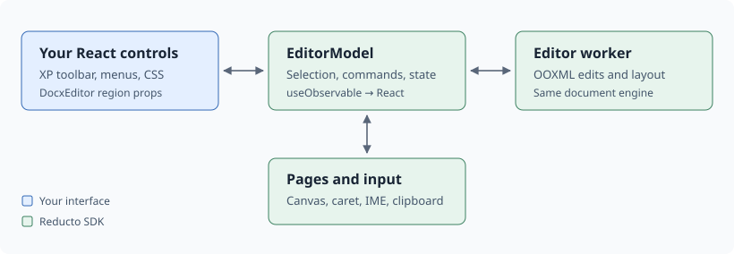
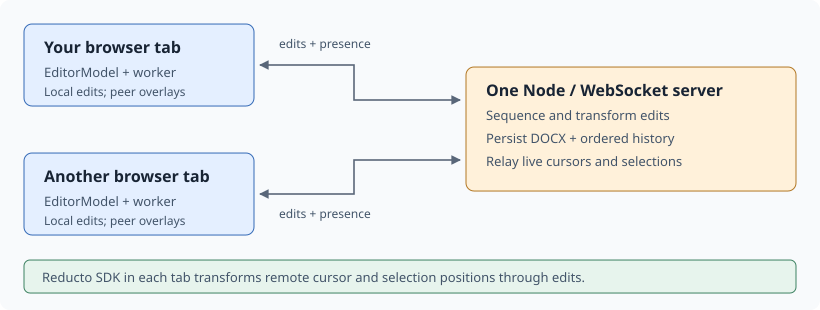

# Reskin WordPad Live

Replace the React toolbar and CSS while Reducto keeps the document, selection, typing, undo and page painting. This app uses `@reductoai/docx-editor` 0.0.11 over `@reductoai/docx` 0.0.29.



Pass every replacement region on the first render: omitted means built-in, `null` removes it. Keep the `document` object stable; changing its identity reopens the file.

```tsx
import { DocxEditor, useObservable } from "@reductoai/docx-editor/react";
import EditorWorker from "@reductoai/docx-editor/worker?worker";
import "@reductoai/docx-editor/style.css";

// Module scope: keep construction options stable across renders.
const spawnWorker = () => new EditorWorker();

<DocxEditor
  worker={spawnWorker}
  fontsUrl="/fonts"
  onReady={setModel}
  toolbar={<YourToolbar model={model} />}
  inspector={null}
  nav={null}
  navClosed={null}
  selection={null}
/>;
```

Subscribe only to fields your control displays. Selection belongs to the model, so a button can keep keyboard focus in the editor:

```tsx
const bold = useObservable(model, (m) => !!m?.format?.bold);
<button
  aria-pressed={bold}
  onPointerDown={(e) => e.preventDefault()}
  onClick={() => model?.toggleBold()}
>
  B
</button>;

await model.run({ kind: "runFormat", format: { font: "Arial", sizePt: 14 } });
model.setAlignment("center");
model.focusInput(); // after a custom picker commits
```

Let text inputs and dropdowns receive normal focus. Use the current selection; restoring an old snapshot can target stale positions after multiplayer edits.

Review controls use the same model, so their markup travels through collaboration and into exported DOCX files:

```tsx
model.setRevisionAuthor(displayName.trim() || "Guest");
model.setSuggesting(!model.suggesting); // Track Changes for this writer
model.startComment(); // SDK composer anchored to the selection
model.review.toggle(); // Show comments and revisions
```

The SDK composer handles posting, replies, and the selected range. Keep the author synchronized when the display name changes; existing comments and revisions retain their historical authors.

Edit [App.tsx](src/App.tsx) for controls and [xp.css](src/xp.css) for appearance. Keep [collaboration.ts](src/collaboration.ts) connected to the same model.

For entirely custom page mounting, use `EditorModel.attach(pages)` and `attachEditorInput(stage, model)` from `/model`; clean up both when unmounting.

## Multiplayer



[collaboration.ts](src/collaboration.ts) connects each model with `startCollab`, `collabRemote`, `collabAck` and `collabPeers`. Keep this connection when replacing the chrome: Reducto paints peers' cursors and selections. Presence currently covers the main document body. [README.md](README.md#multiplayer-behavior) describes conflict rules and reconnect behavior.

## Messenger

Reskin [Messenger.tsx](src/Messenger.tsx) and [messenger.css](src/messenger.css) for the room conversation. `connectRoom` supplies chat state through its fifth callback; wire the returned `sendChat(text)` and `setTyping(active)` to the composer. Render each stored `message.name` to preserve its send-time attribution after renames.

Chat shares the existing `/collab` connection and single Node server. Its last 200 messages persist with the room; typing indicators are temporary. Keep the 2,000-character message limit and server rate of 10 new messages per writer per 10 seconds. Chat stays outside the document model and DOCX export, while the review controls above retain document comments and revisions.

## Clippy controls

The same chat callback now supplies `agent` status, activity, requester, model and `runId`. Pass it to `Messenger`, and wire `onStopAgent` to `connectRoom(...).stopAgent(runId)`. Keep the current run ID in a Stop request so an old button cannot stop a newer task. An addressed message beginning with `@Clippy` delegates or steers work; `@Clippy stop` cancels it for the room. The status card and replies are shared across participants.

[coworker.ts](server/coworker.ts) runs Vercel AI SDK 7 with Sonnet 5.5 by default. Keep model calls and Anthropic configuration on the server; [README.md](README.md#run-locally) describes the application-specific `ANTHROPIC_API_KEY`, `.env.example`, and `AGENT_MODEL`. Changing the skin does not require a second agent or browser-side model key.

## Clippy tools

| Surface                            | What it exposes                                                                                                                               |
| ---------------------------------- | --------------------------------------------------------------------------------------------------------------------------------------------- |
| `read_document`, `search_document` | Scoped paragraphs, exact anchors, formatting, styles and structure; body, header/footer and note stories                                      |
| `read_table`, `read_review`        | Logical cell coordinates and merge spans; comments, replies and tracked revisions                                                             |
| `apply_document_edits`             | One atomic batch of text, paragraph, font, style, list, hyperlink, page-break, table, comment or targeted revision operations                 |
| `search_document_api`              | Recipes for this app's supported operations and constraints                                                                                   |
| `exec`                             | QuickJS scripts calling JSON-only `doc.inspect/search/readTable/review/apply`, `api.search` and `text`; plain state lasts for the current run |
| `read_page`, `render_page`         | Physical-page geometry in points and actual PNG input to the model, using SDK final-view rendering                                            |

The typed schemas live in [document-tools.ts](server/document-tools.ts); [document-executor.ts](server/document-executor.ts) exposes the same operations inside WASM. This follows Reducto's programmatic read–edit–inspect pattern with a deliberately narrower surface: it supplies neither arbitrary live SDK handles nor a shell, host filesystem, network or Node globals.

For example, a script can read the current sequence and make one guarded change:

```js
const current = await doc.inspect({ limit: 10 });
text(
  await doc.apply({
    expectedSeq: current.seq,
    operations: [
      {
        op: "replace_text",
        anchor: { text: "thirty days", expectedMatches: 1 },
        replacement: "sixty days",
      },
    ],
  }),
);
```

Each batch stages a fresh session, records edits under **Clippy** with tracking enabled, restores the saved tracking setting, and submits its delta only if the room sequence still matches. A stale sequence or failed operation commits nothing from that batch. Earlier successful batches remain after a later script failure, Stop, steering or restart. Fresh reads are essential: indexes change after insertions, body paragraph collections include table cells, and merged cells require logical column coordinates.

QuickJS limits guest scripts to 15 seconds, 32 MiB of heap, 25 document/API calls and five edit batches; a batch allows 50 operations. Those limits cover guest code; host document operations have their own input and output caps. [layout-tools.ts](server/layout-tools.ts) runs page work in cancellable workers with a 20-second limit, at most 200 pages, 32 MiB DOCX input and PNG output capped at four megapixels/8 MiB. Page numbers are one-based. `render_page` explicitly reports renderer unavailability; geometry or metadata alone is not visual verification, and portable-font results are not proof of Word parity.

The single Node process permits one current task per room, four active rooms, 30 model steps and ten minutes per attempt. It saves task state and completed tool outcomes alongside room data, and fences commits from stopped or superseded attempts. Unfinished tasks become **Interrupted** after restart; `@Clippy continue` starts another attempt that rereads the saved document rather than automatically replaying paid model work.

References: [React example](https://docx-internal.reducto.ai/simple-editor/#App.tsx), [full editor](https://docx-internal.reducto.ai/word/). The installed package's `README.md` covers headless mounting; current types are in `node_modules/@reductoai/docx-editor/dist/types`.
